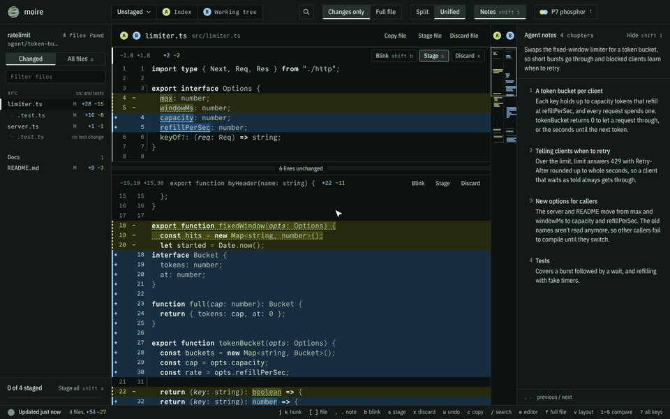

# moire

[](https://github.com/backstabslash/moire/actions/workflows/ci.yml)
[](https://github.com/backstabslash/moire/releases/latest)
[](https://www.npmjs.com/package/@backstabslash/moire)
[](#install)
[](LICENSE)

**See exactly what your coding agent changed, and keep only what you want.** A fast desktop diff viewer for git: stage by line, search every change, and blink between old and new.



- Side-by-side or unified diffs with syntax highlighting: unstaged, staged, everything since the last commit, a single commit, or one branch against another
- Stage, unstage and discard whole files, hunks or single lines, with undo, and commit from the staged view
- Updates by itself as files change
- Search across every changed file; lockfiles, generated files and whitespace-only changes are folded away
- Copy selected lines as code, or as Markdown with path and line numbers to paste into an agent
- Blink a hunk between its old and new version in place, so small changes jump out
- Changed images shown old and new; Markdown and SVG can be previewed rendered, with changed blocks marked

## Install

```sh
npx @backstabslash/moire
```

installs the latest release, then opens the repo in the current directory. Run it again to update. On Linux it adds moire to your app menu and a `moire` command to `~/.local/bin`; on macOS it installs to `~/Applications`. moire needs `git` on your PATH.

Or download from [Releases](https://github.com/backstabslash/moire/releases):

- **Linux:** AppImage, `.deb` or `.rpm`. The AppImage updates itself; the `.deb` and `.rpm` also install a `moire` command.
- **macOS:** `.dmg` for Apple silicon or Intel. Builds aren't notarized yet, so the first time macOS blocks the app. Open System Settings → Privacy & Security and click Open Anyway.

## Use

```sh
moire                 # reopens the last repo
moire path/to/repo
```

On macOS: `open -na moire --args "$PWD"`. Inside the app, `o` lists recent repos.

| Key | Action |
| --- | --- |
| `j` `k` | Next / previous hunk |
| `[` `]` | Previous / next file |
| `1`–`5` | Unstaged, staged, all, commit, branch vs branch |
| Click or drag line numbers | Select lines (Shift-click extends) |
| `s` | Stage the selection or focused hunk (unstage in the staged view) |
| `x` | Discard the selection or focused hunk |
| `u` | Undo the last stage, unstage or discard |
| `b` / `Shift+B` | Hold to flip the focused hunk to its old version / keep it blinking |
| `Ctrl+C` / `c` | Copy selected lines as code / as Markdown for an agent |
| `/` or `Ctrl+F` | Search |
| `p` or `Ctrl+P` | Filter the file list |
| `a` | Changed files or all files, gitignored ones included |
| `e` | Open the file in your editor at that line (set `MOIRE_EDITOR`, e.g. `code -g {file}:{line}`, to choose) |
| `o` | Recent repos |
| `f` | Show full files |
| `v` | Split or unified layout |
| `m` | Preview a Markdown or SVG file, or go back to its diff |
| `t` | Light or dark theme |

## Build from source

```sh
pnpm install
pnpm dev     # run against the last repo, or set MOIRE_REPO=path
pnpm dist    # packages for the current OS into dist/
```
